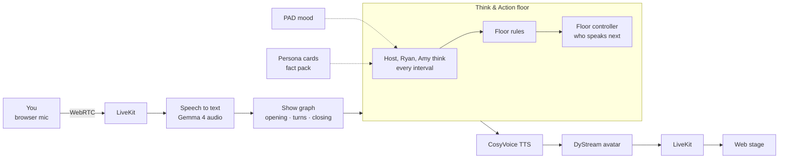

<div align="center">

# AI Agent Talk Show

**A live, voice-in / voice-out talk show with three AI hosts and panelists, and a benchmark for what makes them good.**

Host **Claire** moderates, commentator **Ryan** pushes back, guest **Amy** brings it back to people.
You join from the browser and take the floor just by speaking.

[Setup](SETUP.md) · [Benchmark](eval/bench/README.md) · [Dialogue quality report](eval/DIALOGUE_QUALITY.md) · [Contributing](CONTRIBUTING.md)

</div>

---

## Highlights

- **Talks like a panel, not a chatbot.** Every listener thinks while someone is speaking and decides whether to
  speak, interrupt, back-channel or stay quiet. A floor controller picks who goes next, and deterministic floor rules
  keep interruptions grounded and polite.
- **Live voice and faces.** Audio in through Gemma 4, speech out through CosyVoice, optional lip-synced DyStream
  avatars, all streamed over LiveKit to a Next.js stage.
- **Moods that carry over.** Each AI keeps a PAD (pleasure, arousal, dominance) mood that shifts with what it hears;
  it goes into the think prompts and the voice instruction for speech.
- **Swappable personas.** Structured persona cards (role, leaning, style, signature moves, things to avoid) can be
  dropped into any seat.
- **Measured, not guessed.** An open benchmark scores whether the panel listens, answers the right person, sticks to
  checked facts, stays in character and makes a watchable show, with open-model judges that are validated before use.

## How it works



**One line, step by step**

1. While someone speaks, the host and both panelists each make a short *think* call: what is the point, and do I
   want the floor? Each returns a decision and a draft line.
2. When the floor is free, the floor controller picks the best draft or asks the host to step in. With the dialogue
   quality settings on, a panelist the audience named answers first.
3. The chosen draft is spoken, interval by interval, so the others can react, interrupt or back-channel mid-line.

## Benchmark

The benchmark treats a talk show like an environment: fixed inputs, any system plugs in through one interface, and
every score comes from rules or validated judges. Most tasks are counterfactual pairs: change one thing in the
input and check whether the reply changes as it should.

| Task | What changes | What a good system does |
| --- | --- | --- |
| **T1** Listening | A number, stance, name or cause in the audience turn | The reply changes with the edit, not with a paraphrase |
| **T2 / T2f** Addressing | The audience names Ryan or Amy | The named panelist answers; the floor goes to them |
| **T3a / T3b** Grounding | One number in the checked facts | The reply uses the new value and invents nothing |
| **T4** Persona | The two persona cards are swapped | The style follows the card |
| **T6** Full show | Nothing: a whole episode around a fixed audience script | Judged pairwise as a show; repetition and flow counted |

Test split: 42 motions from public debates (Intelligence Squared, via ConvoKit), 937 items, 3 reruns, two open
judges (Qwen2.5-72B, Llama-3.3-70B).

### Results so far

| System (test split, 0 to 100) | Overall | Listening | Grounding | Persona |
| --- | ---: | ---: | ---: | ---: |
| Show, best settings, Qwen3.6-35B-A3B panel | **45.0** | **27** | **54** | **87** |
| Show, best settings, Gemma-4 E4B panel | 40.4 | 20 | 47 | 86 |
| Plain Gemma-4 E4B, no show logic | 34.4 | 15 | 35 | 85 |
| Show, original settings | 33.5 | 9 | 36 | 81 |

Benchmark runs are offline; the Qwen panel has not been run in the live stack yet.

What moved the needle: showing panelists the right context, structured persona cards, letting the named person
answer, and a stronger panel model. What did not: adding more style rules and examples to the prompt. Full numbers,
ablations and known limits are in the [dialogue quality report](eval/DIALOGUE_QUALITY.md).

## Quick start

| I want to | Go to |
| --- | --- |
| Run the full voice show (3 GPUs) | [SETUP: How to run a session](SETUP.md#how-to-run-a-session) |
| Run a text-only show on one GPU | [SETUP: text-only mode](SETUP.md#4-optional---text-only-mode-babel) |
| Drive a show with a scripted audience | [eval/ghost_session](eval/ghost_session/README.md) |
| Turn on the dialogue quality settings | [SETUP: dialogue quality fixes](SETUP.md#5-optional---dialogue-quality-fixes) |
| Score a system on the benchmark | [eval/bench](eval/bench/README.md) |
| Set up a laptop or the cluster | [SETUP: teammate setup](SETUP.md#teammate-setup--laptop-one-time) |

## Repository layout

```
agent/            Live agent: show graph, Think & Action floor, panel prompts, personas, emotion
talkshow-web/     Next.js stage (panel, transcript, avatars)
config/           Personas, persona library, scenarios, dialogue style libraries
deploy/           Job scripts, vLLM, CosyVoice and DyStream sidecars, flag presets
eval/             Benchmark (bench/), quality ruler, ghost sessions, fact packs, reports
tests/            Unit and integration tests
api/tokens.py     LiveKit token helper for the laptop
```

## Data and licences

Fact packs quote Wikipedia (CC BY-SA 4.0); every fact keeps its page and URL. Test topics come from the Intelligence
Squared debates corpus (Zhang et al., NAACL 2016). The test text is rebuilt locally and never committed; only item
ids and edits are.

---

<div align="center">
CMU capstone project · all tracked files are in English, see <a href="CONTRIBUTING.md">CONTRIBUTING</a>
</div>
