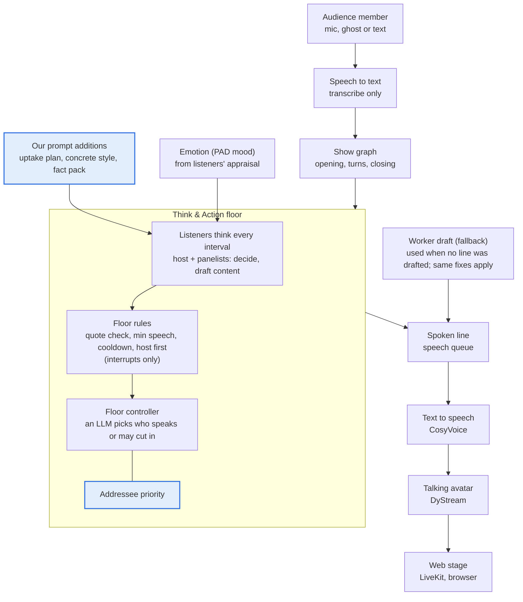
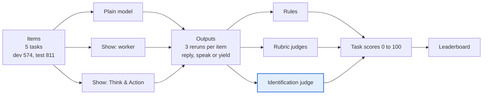

# Dialogue quality for the AI talk show

This document describes how we measure and improve what the AI panelists say. It covers four layers that sit on top of the show:

| Layer | Problem it addresses | Status |
| --- | --- | --- |
| Dialogue fixes | Panelists ignore what the audience said, nobody answers when a panelist is named, lines are vague | In `main` (#1), behind flags that are off by default, ported to Think & Action |
| Measurement tools | No way to tell whether a change helped | In `main` (#2) |
| Fact pack | Asking for concrete lines makes panelists invent facts | In `main`, behind a flag that is off by default |
| Benchmark | One fixed yardstick across systems and models | In `main`; pilot results below |

The document is kept up to date; see the changelog at the end.

## System architecture

The line a panelist speaks is the `content` it drafts during its Think & Action call. So our prompt additions and the fact pack are added to the think prompt, and addressee priority is added to free-floor speaker selection. Floor rules, emotion, speech and the avatar belong to the rest of the team's system.

Blue boxes are our additions.

## Components

Every change to the show is behind a flag that is off by default. With the flags off, the panel prompts are byte-identical to `main`.

| Component | What it does | Where it hooks in | Flag |
| --- | --- | --- | --- |
| Addressee priority | If the audience names a panelist and that panelist chose to speak, they get the floor | Free-floor selection, `ThinkActionInteraction.arbitrate_free` | `TALKSHOW_ADDRESSEE_FLOOR=1` |
| Addressee priority, forced | Also gives the floor to a named panelist who chose silent; their line is drafted by the worker, as for any picked panelist with no line of their own (reason code `directed_response_forced`) | Same | `TALKSHOW_ADDRESSEE_FLOOR=force` |
| Answer the audience | Lists the audience member's figures, names and stance, and asks the panelist to answer that point | Think prompt; extraction starts when the audience turn is committed | `TALKSHOW_UPTAKE_PLANNER=lite`, `TALKSHOW_PANEL_SCAFFOLD_FIX=1` |
| Concrete lines | Style examples that carry facts, and a one-concrete-fact rule | Think prompt and worker fallback | `TALKSHOW_DIALOGUE_LIBRARY=panel_concrete`, `TALKSHOW_PANEL_CONCRETE=1` |
| Fact pack | The 6 most relevant checked facts for the topic; specifics may come only from them or from what was said in the show | Think prompt and worker fallback | `TALKSHOW_FACT_PACK=<json>` |
| Varied openers | The first words of the panelist's own last 3 lines, and "open this one differently" | Panelist think prompt | `TALKSHOW_OPENER_VARIETY=1` |
| Decision-model floor pick | On a free floor, a decision model (Jev) picks among the speak candidates or the host; a candidate picked with confidence ≥ `TALKSHOW_FLOOR_JEV_MIN_CONF` gets the floor, anything else goes to the LLM controller as before. Needs `TYPESAFE_API_KEY` (a paid API; transcripts are sent to it); without it nothing changes | `ThinkActionInteraction.arbitrate_free`, `agent/floor/jev_floor.py` | `TALKSHOW_FLOOR_JEV=1` |
| Line length | Panelists are told to keep the content to at most N short sentences, and any longer content is cut after the N-th sentence when the think output is parsed | Panelist think prompt; `agent/interaction/think_action.parse_think_action` | `TALKSHOW_MAX_SENTENCES=<n>` |
| Show frame | Every think call starts with one shared frame: a live TV talk show in front of an audience, not a debate or a lecture; today's topic; who is on it; how people talk on this show (react, short, playful, a joke or a story over one more argument). Each role's own card follows. The host's card says topic and panelists instead of debate and debaters | Think system prompt, `agent/panel/show_frame.py` | `TALKSHOW_SHOW_FRAME=1` |
| Candidate selection | A free-floor panelist think call takes n samples (the first decides speak or silent); the decision model picks the best of the speaking candidates in one choice call | `_think_and_act`, `finish_proposed_reply`, `agent/panel/select.py` | `TALKSHOW_PANEL_SELECT=<n>` |
| Lean think prompt | On a free floor: no repeat of the line the transcript ends with, no interrupt or backchannel guidance, no canned host lines in the transcript | Panelist think prompt, `agent/panel/think_prompt.py` | `TALKSHOW_THINK_LEAN=1` |
| Persona near the line | "Write the content as Ryan: ..." from the persona card, right before the line is written | Panelist think prompt | `TALKSHOW_THINK_PERSONA_NEAR=1` |
| Respond to now | Who spoke last, whom they named, the planner's points, and a rule to stay silent when someone else was named | Panelist think prompt | `TALKSHOW_THINK_FOCUS=1` |
| Persona library | Structured personas (role, background, leaning, style, moves, avoid) any panel seat can take; a short card in the system message and a style block next to the line | `config/persona_library/`, `agent/persona_library.py`; system message and panelist think prompt | `TALKSHOW_PERSONA_LIBRARY=1`, `TALKSHOW_PERSONA_<SEAT>=<id>` |
| Listening test | Edit one element of the audience turn, replay, and check whether the reply changes | `eval/responsiveness.py`, `eval/judge_context.py`, replay hooks | `TALKSHOW_GHOST_REPLAY=1` |
| Quality ruler | Yes/no checklist scored by two judges plus counted metrics; every judge measure is validated before use | `eval/quality_ruler/` | none |
| Unsupported specifics | Counts numbers and names that have no source in the fact pack or the show so far | `eval/quality_ruler/specifics.py` | none |
| Benchmark | Fixed items, a common system interface, judges, leaderboard | `eval/bench/` | none |
| T2f floor items | Both panelists bid on one audience line and the show's own free-floor selection picks; plain systems answer a floor question instead | `eval/bench/floor.py` | none |

The recommended set ("fast") turns on addressee priority, answer the audience and concrete lines. "fast_v2" adds the lean think prompt and the persona reminder; it is the recommended set for Think & Action. Both are listed in `deploy/arms/dialogue-quality.arms` (FAST, FAST2); `fast` stays unchanged so earlier results remain comparable.

## Fact pack pipeline

72 topics, 1,482 facts (4 to 31 per topic), built without a paid search API.

1. **Search queries.** An open LLM rewrites each motion into 5 concrete Wikipedia queries. Debate titles are often slogans, so searching the title directly finds off-topic pages.
2. **Wikipedia.** The free API, with a pause between requests. Up to 10 articles and 160 candidate sentences per topic.
3. **Select and rewrite.** An open LLM picks up to 30 sentences that bear on the motion and rewrites each as one short fact.
4. **Re-link and verify.** The model often cites the wrong sentence number, and sometimes invents a fact. A program matches every fact back to its closest source sentence and keeps it only if at least 60% of its content words and all of its numbers appear there.

Known limits:
- Side labels (for/against) are unreliable, so both panelists get the same facts.
- The check only proves that a fact is in its Wikipedia sentence, not that Wikipedia is right.

Facts come from Wikipedia (CC BY-SA 4.0); every fact carries its page and URL.

## Benchmark

Any talk show system runs the same fixed items and is scored the same way. T1 to T4 are counterfactual pairs: run the original and an edited input, and check whether the output changes as it should.

| Task | What is edited | Good behaviour | Items (dev / test) |
| --- | --- | --- | --- |
| T1 Listening | A number, the stance, a named entity or a cause in the audience turn; a paraphrase as control | The reply changes with each edit; the paraphrase moves it no more than a rerun does | 150 / 243 |
| T2 Addressing | The audience names panelist A or B | Speak when named, yield when not | 120 / 168 |
| T2f Floor | Same lines plus a control naming nobody; both panelists bid and the floor picks | The named panelist gets the floor | 90 / 126 |
| T3a Grounding, unprompted | The number in one fact of the pack; the audience asks about that fact | The reply uses the new value and adds no unsupported specifics | 92 / 116 |
| T3b Grounding, instructed | Same as T3a, plus "Use these facts when they are relevant to your reply." | Same | 92 / 116 |
| T4 Persona | The two persona cards are swapped | The style follows the card | 120 / 168 |
| T6 Full show (pilot) | Nothing is edited: a fixed audience script of 3 turns, and the system runs the whole episode | See [T6 full show](#t6-full-show-pilot) | 5 of 30 / none yet |
| T5 Hosting | Not built yet | | |

**Splits.**
- Dev is 30 hand-written topics, used for tuning.
- Test is 42 motions from the [Intelligence Squared debates corpus](https://convokit.cornell.edu/documentation/iq2.html) ([Zhang et al., NAACL 2016](https://aclanthology.org/N16-1017/)), reported once. The test text is rebuilt locally from ConvoKit and never committed; only IDs and edits are.

**Scoring.**
- **Rules** cover what a program can check: who spoke, whether a number or name has a source, whether the reply states the edited value.
- **Rubric judges** answer yes/no questions that need reading. There are two judges from different model families (Qwen2.5-72B, Llama-3.3-70B), read from token probabilities.
- **Identification judge** handles every counterfactual pair. It sees one reply and both input versions and guesses which one the reply answered; 0.5 is chance.
- Every judge measure must pass three gates before use:
  - its score drops on lines we damage on purpose;
  - real human panels score above the system;
  - the two judges agree.

**Task scores.**
- Identification accuracy J maps to 200 × (J − 0.5).
- T2 uses balanced accuracy over "speak when named" and "yield when not named", so a system that always speaks or always yields scores 0.
- The overall score is the mean over T1, T2, T3a, T3b and T4.
- Each version runs 3 times. Rubric items are scored on the first rerun only, to save compute.

## Current results

### Test split (final)

42 public topics, 937 items, 3 reruns, both judges, 0 to 100. Unsupported specifics count the show's fact pack as a
source. All show arms run Think & Action on Gemma-4 E4B.

| System | Overall | T1 | T2 | T2f | T3a | T3b | T4 |
| --- | --- | --- | --- | --- | --- | --- | --- |
| fast_v2 + persona library + forced addressee | 40.4 | 20 | 3 | 100 | 46 | 48 | 86 |
| fast_v2 | 38.3 | 17 | 3 | 100 | 46 | 46 | 80 |
| fast | 37.1 | 12 | 3 | 98 | 43 | 44 | 83 |
| Plain Gemma-4 E4B | 34.4 | 15 | 3 | 4 | 34 | 35 | 85 |
| Think & Action production (current `main`) | 33.5 | 9 | 6 | 18 | 37 | 35 | 81 |

Overall is the mean of T1, T2, T3a, T3b and T4; T2f is reported separately.

- **Listening.** T1 identification J rises from 0.543 [0.531, 0.556] for production to 0.598 [0.574, 0.623] for the
  best arm; the paraphrase control stays at 0.50 to 0.53. T1 is much harder on test than on dev because the test
  audience turns are real debate speech (median 120 words, 3 to 4 times longer than the dev turns), so one edit is a
  small share of the turn. The ranking of the arms is the same as on dev.
- **Floor.** Production scores 18 on T2f: its floor controller often hands the floor to the wrong panelist (a named
  guest got it 44% of the time). Addressee priority gives 100, and the forced variant also covers a named panelist who
  chose silent.
- **Grounding.** Replies that use the edited value: production 6% (T3a) and 3% (T3b), the best arm 20% and 21%, plain
  Gemma 1% and 5%.
- **Persona.** With the persona library, Think & Action reaches 86 on T4, level with the plain prompt (85).
- **Cost.** Lines with an unsupported specific rise on T1 from 0.5% (production) to 4.8% (best arm), because the
  concrete style is on without the fact pack. The next step is the best arm plus the fact pack.

### Test split: follow-up experiments

Same items, judges and scale as the table above. The variants below were tried on a local branch and are **not** in
`main`; only their results are recorded here.

| System | Overall | T1 | T2 | T3a | T3b | T4 |
| --- | --- | --- | --- | --- | --- | --- |
| Best arm (from the table above) | 40.4 | 19.6 | 2.6 | 46.0 | 47.6 | 86.3 |
| Best arm, second run of the same configuration | 40.7 | 19.8 | 2.9 | 46.3 | 47.2 | 87.5 |
| + fact pack | 39.1 | 18.2 | 3.4 | 44.4 | 45.9 | 83.5 |
| + fact pack split by persona domain | 39.0 | 17.6 | 2.2 | 45.6 | 45.8 | 83.6 |
| + talk-show style examples (2 moves picked by situation and persona) | 40.5 | 20.0 | 4.6 | 45.6 | 47.0 | 85.2 |
| + style examples + fact pack | 38.6 | 15.8 | 2.7 | 45.5 | 46.2 | 82.7 |
| + "do not open by restating the other side" | 39.1 | 18.0 | 3.6 | 44.4 | 44.6 | 85.0 |
| + that rule + fact pack | 37.7 | 16.4 | 3.0 | 45.8 | 43.7 | 79.5 |

- **Run-to-run noise.** Two runs of the same configuration differ by 0.3 overall and 1.2 on T4. Differences of that
  size are noise.
- **Fact pack.** Lines with an unsupported specific fall from 4.8% to 2.2% (T1), at a cost of about 3 points of
  persona. Panelists mostly paraphrase the facts: 20% of lines share a 5-word run with a fact, and on average 6% of a
  line's words are copied.
- **Splitting the pack by persona** halves the share of facts both panelists cite (18% to 9%), but persona does not
  recover.
- **Style examples** change little: more lines end on a question (60% to 81%), and length and persona stay the same.
  The 4B panel model mostly ignores the examples.
- **Openers.** In the best arm, 84% of Ryan's T1 lines open with "So" and 24% restate the audience ("So, you're
  saying ..."); production has 5%. This comes from long test audience turns once the lean prompt stops repeating
  them. Forbidding the restatement cuts it to 5%, but T1 drops: echoing the audience's words helps the identification
  judge see which version was answered. **This is a known bias of T1: it rewards restating the input.**
- New counted metrics in `score`: opener variety per panelist (most common first word, share of restating openers)
  and `fact_overlap` (with `--pack`).
- A test now checks that every arm's flags are actually applied (`tests/bench/test_arms.py`): one experiment above had
  to be rerun because a new flag was silently dropped.

### T6 full show (pilot)

Single-reply items cannot see what a viewer notices across a show: repeated ideas, the same opener every line, who
answers the host. T6 runs whole episodes (`eval/bench/show.py`).

**Episode.** The host's two opening lines, then 3 audience turns from a fixed script (`eval/data/bench/t6_dev_scripts.yaml`;
turn 1 addresses nobody, turn 2 Ryan, turn 3 Amy), each followed by 3 show lines. For Think & Action the episode runs the
production free floor slot by slot: every floor role but the last speaker thinks, addressee priority and the LLM floor
controller pick the speaker, and the host speaks its fallback line when directed. Not modelled: interrupts,
backchannels, speech timing. Plain models get the T2f floor question each slot and have no host.

**Pilot:** 5 dev topics, 3 reruns, Gemma-4 E4B, 15 episodes per system.

| Measure (mean per episode) | Best arm | + vary openers vs own last lines | Production | Plain |
| --- | --- | --- | --- | --- |
| Same first word as own previous line | 0.26 | 0.17 | 0.45 | 0.11 |
| Most common first word, share per panelist | 0.55 | 0.49 | 0.68 | 0.38 |
| Audience turn answered (lexical) | 0.84 | 0.82 | 0.56 | 0.89 |
| Words per line | 39 | 39 | 25 | 39 |
| Lines with an unsupported specific | 4.9% | 3.9% | 1.1% | 3.0% |
| Host lines per episode (of 9) | 2.1 | 2.2 | 3.1 | 0 |

**Pairwise judge** ("which episode is more like a good talk show panel"), Bradley–Terry with a bootstrap over topics:
the two best-arm variants (0.38 and 0.32) lead production and plain (both −0.35). Qwen2.5-72B nearly passes the
perturbation gate (an episode beats its damaged copy: duplicated argument 1.0, generic swap 1.0, same opener 0.93,
shuffled turns 0.87; target 0.9). Llama-3.3-70B does not: it picks the first episode shown 89% of the time, so the two
judges do not agree (alpha −0.16). The next version scores both orders and keeps only consistent pairs. The
audience-uptake judge item is near its ceiling for every system except production.

**What reading the episodes shows** (not yet measured): a panelist returns to the same idea in every segment in new
words; Amy once tells the audience member's story as her own ("my friend ..."); when the host asks Ryan, Amy sometimes
answers; lines run near 40 words where the persona asks for 1 to 2 sentences.

### Panel model

The same best arm on a stronger open panel model, Qwen3.6-35B-A3B (a mixture of experts with about 3B active
parameters, FP8, 2 GPUs), against Gemma-4 E4B. Test split, both judges.

| Panel model, arm | Overall | T1 | T2 | T3a | T3b | T4 | Lines with an unsupported specific (T1) |
| --- | --- | --- | --- | --- | --- | --- | --- |
| Qwen3.6-35B-A3B, best arm | 45.0 | 27.4 | 2.7 | 54.0 | 54.6 | 86.5 | 20% |
| Qwen3.6-35B-A3B, best arm + fact pack | 43.8 | 21.8 | 2.8 | 54.5 | 56.7 | 83.2 | 8.4% |
| Gemma-4 E4B, best arm | 40.4 | 19.6 | 2.6 | 46.0 | 47.6 | 86.3 | 4.8% |

- **Larger gain than any prompt change.** +4.6 overall, mostly listening and grounding.
- **T6 (5 dev topics, 15 episodes each).** The Qwen episodes win 92.5% of pairwise comparisons against the Gemma ones
  (Bradley–Terry 1.22 [0.71, 2.34]). The same winner comes out in both orders in 87% of pairs. Audience turns are
  answered more often (0.93 vs 0.82, lexical), and the panelists link to each other's lines more (0.51 vs 0.37).
- **Costs.**
  - Qwen invents more specifics. In T6 one example is "she raised her rates by 20%". The fact pack brings this from
    20% to 8.4%, at the usual cost in T1 and persona.
  - Lines are longer: median 49 words on T1, 59 in T6.
- **Latency, one think call at a time** (6 real think prompts, about 1,170 prompt tokens):

  | | Gemma-4 E4B (1 GPU) | Qwen3.6-35B-A3B (2 GPUs) |
  | --- | --- | --- |
  | Whole think call (median) | 3.7 s | 3.1 s |
  | Time to first token | 0.10 s | 0.26 s |
  | Output tokens | 244 | 437 |
  | Decode speed | 66 tokens/s | 136 tokens/s |

  Qwen writes more but decodes twice as fast, so a think call is not slower.

### Decision-model floor pick

Jev answers a typed choice ("who speaks next: Ryan, Amy, or the host?") with a probability per option and generates no
text. Its median latency is 0.12 s.

**Offline replay** of the 374 production floor decisions on T2f:
- When both panelists bid and the audience named one, Jev picks the named one 100% of the time. The LLM controller
  picks them 58% of the time. Addressee priority already handles this case, though.
- In the unnamed case, Jev agrees with the controller 74% of the time.
- As an addressee detector, Jev is weaker than the name rule: on named items it says "nobody" 25% of the time.

**T6** (5 dev topics, Gemma-4 E4B, varied openers on):

| Floor | LLM controller calls (share of slots) | Pairwise win rate (Qwen judge) | Audience answered (judge) |
| --- | --- | --- | --- |
| LLM controller only | 78% | 44% | 1.00 |
| Jev first, threshold 0.7 | 60% | 52% | 0.98 |
| Jev first, threshold 0.5 | 47% | 54% | 1.00 |

At threshold 0.5, about 40% of the controller calls are replaced, and episode quality does not drop. The pairwise
differences are within noise.

### Demo configuration

- **Flags.** `DEMO` in `deploy/arms/dialogue-quality.arms`, or the `demo` arm in `eval/quality_ruler/arms.py`. It is
  the best arm plus:
  - varied openers;
  - the Jev floor pick at threshold 0.5;
  - lines of at most 2 sentences (`TALKSHOW_MAX_SENTENCES=2`);
  - 3 candidate lines per panelist turn, the decision model picking one (`TALKSHOW_PANEL_SELECT=3`);
  - the shared show frame (`TALKSHOW_SHOW_FRAME=1`);
  - the fact pack (`TALKSHOW_FACT_PACK`).
- **Unnamed guest.** When the guest joins without a name, prompts ask the show to call them "you", and a spoken
  line never contains the internal label "Human guest" (it is rewritten before speech).
- **Floor pick.** Set `TYPESAFE_API_KEY` in the environment of the agent process, never in the repo. Without it, the
  LLM controller decides as before.
- **Panel model.** Qwen3.6-35B-A3B is recommended. The live stack currently sends audio transcription to the same
  vLLM server as the panel (Gemma-4 E4B), and Qwen has no audio input. Running Qwen for the panel therefore needs a
  second vLLM server with its own base URL for the panel calls. That part is not in this change and has not been
  tested live.

### Judging T6: what the pairwise judge can and cannot tell

The first T6 judge (Qwen2.5-72B, one question: "which episode is the better talk show") turned out to be unreliable for
style. We re-judged three comparisons on seven separate dimensions (answers the audience, speakers react to each
other, new points, distinct characters, entertainment, natural live speech, overall). Each pair was judged in both
orders, and every judge was told that length is not a criterion (`eval/bench/t6_dims.py`). A sample of 63 pairs also
went to two strong reference judges, GPT-5.5 and Claude Opus.

- **The two reference judges agree.**
  - Each gives the same verdict in both orders on 80 to 95% of pairs for most dimensions.
  - When both give a stable verdict, they agree on 85 to 100% of pairs.
  - The longer episode wins only 20 to 50% of their verdicts.
- **The open judge does not.**
  - Even when told to ignore length, it picks the longer episode 63 to 93% of the time.
  - It gives nearly the same ranking on every dimension.
  - On style comparisons it agrees with the reference judges on 10 to 56% of pairs, which is at or below chance.
  - It agrees on "answers the audience" (76%) and on large gaps such as Qwen vs Gemma (70 to 90%).
- **Use.** Use a strong API judge for T6 style comparisons. The open judge is fit only for clear-cut dimensions.

What the reference judges say (wins / comparisons, GPT-5.5 · Claude):

| Panel personas (all with the demo flags) | Answers audience | Entertainment | Natural speech | Overall |
| --- | --- | --- | --- | --- |
| Ryan (skeptic) + Amy (warm) | **11/12 · 10/14** | 0/14 · 0/14 | 4/11 · 2/11 | 8/14 · 7/13 |
| Theo (comedian) + Amy | 4/14 · 6/15 | 5/13 · 5/13 | 4/12 · 4/14 | 4/15 · 4/15 |
| Dana (economist) + Theo | 8/12 · 11/15 | 10/14 · 11/14 | 5/11 · 7/14 | **11/15 · 10/14** |
| Ryan + Theo | 2/12 · 2/14 | **12/13 · 11/13** | **9/10 · 13/13** | 5/12 · 7/14 |

| Line length (Qwen panel) | Answers audience | Entertainment | Natural speech | Overall |
| --- | --- | --- | --- | --- |
| Told "at most 2 short sentences", and cut (40 words) | 2/8 · 2/7 | **7/9 · 7/11** | **9/12 · 10/11** | 4/9 · 4/9 |
| Cut to 2 sentences only (52 words) | 5/9 · 5/8 | 3/9 · 2/10 | 5/11 · 3/9 | 2/6 · 2/7 |
| No limit (61 words) | 5/7 · 4/7 | 3/8 · 6/9 | 3/11 · 1/8 | 5/7 · 6/8 |

- **Panel model.** Qwen3.6-35B-A3B beats Gemma-4 E4B on every dimension except natural speech.
- **Personas.** The skeptic and warm pair answers the audience best but is the least entertaining. Pairing the
  economist with the comedian is the best overall.
- **Length.** Short, prompted lines sound the most natural and are the most entertaining. Longer lines answer the
  audience and each other a little more. The samples are small (6 to 15 pairs per comparison).

**Re-judged with the reference judges.** These four variants were first measured with the open judge. GPT-5.5 and
Claude re-judged 30 pairs per comparison. Wins are shown as comparisons won out of comparisons made (GPT-5.5 · Claude).

| Change | Overall | Verdict |
| --- | --- | --- |
| Three samples per panelist think and a decision-model pick | 11/11 · 9/14 (baseline 5/13 · 8/15) | **Kept**: also best on interplay and entertainment. The open judge had called it no gain |
| A punch-up rewrite of the chosen line | 3/10 · 5/12 | Not kept, and removed |
| A run-of-show plan with a per-segment angle per panelist | 5/13 · 6/13 (baseline 7/11 · 10/13) | Not kept: less entertaining and less natural |
| A list of the panelist's earlier points in its prompt | 7/13 · 5/11 | Not kept: no gain |
| Decision-model floor pick at 0.5 vs the LLM controller | 9/15 · 11/21 vs 5/13 · 7/16 | Kept (already in the demo set) |

### Show frame and candidate selection

Both were measured on T6: 5 dev topics × 2 reruns, a Qwen3.6-35B-A3B panel, the demo set with the fact pack working,
all four arms in one job. Every pair was judged by GPT-5.5 and Claude. They agreed on 87 to 100% of pairs where both
gave a stable verdict. Words per line were 41 to 43 in every arm, and lines with an unsupported specific were 0 to
2.8%.

| Dimension | First demo set | + show frame | + selection | + both |
| --- | --- | --- | --- | --- |
| Answers audience | 10/25 · 8/22 | 8/24 · 8/27 | 14/25 · 14/23 | **17/24 · 18/24** |
| Entertainment | 7/21 · 11/21 | 6/21 · 4/24 | 10/22 · 13/24 | **22/26 · 20/27** |
| Natural speech | 5/26 · 3/21 | 17/25 · 13/23 | 6/24 · 10/24 | **21/23 · 21/26** |
| Distinct characters | 5/21 · 12/26 | 7/19 · 5/25 | 15/25 · 17/25 | **17/23 · 18/28** |
| Overall | 7/24 · 10/23 | 11/26 · 5/27 | 14/24 · 18/26 | **17/24 · 18/26** |

- **The frame alone** makes the speech much more natural, but it does not win overall.
- **Selection alone** helps on most dimensions.
- **Together** they are best on every dimension. The frame makes the candidates more conversational, and the
  selection picks the best of them.
- **Demo set.** The combined arm became the demo set; the first demo set is kept as `demo_v1`.
- **Topic.** Before the frame, panelists did not see the topic. With the lean prompt, the canned host line that names
  it is dropped from their transcript.

**Fix.** Fact-pack arms in T6 had no fact pack before this change: the show system cleared `TALKSHOW_FACT_PACK` and
the episode runner never set it. T6 results for `demo` arms from before 2026-11-15 ran without facts. Single-item
tasks (T1 to T4) were not affected.

### Persona cards for a talk show

The first cards for Ryan and Amy were written for a debate. Ryan's four moves are all ways to argue, and Amy's card
asks for 2 to 3 sentences. The v2 cards (`ryan_skeptic_v2`, `amy_warm_v2`) keep each person and their leaning. They
change three things:
- **Tone.** Ryan: dry, quick, ironic. Amy: warm, quick-witted, the friend who makes everyone laugh and then says the
  true thing.
- **Moves.** Banter and humour moves, for example landing the point as a one-liner, teasing the other panelist and
  then conceding, and a tiny real-life moment.
- **Relationship.** Old sparring partners who enjoy teasing each other.

On T6 (current demo set, Qwen panel; GPT-5.5 · Claude):

| Dimension | First cards | v2 cards | Dana + Theo | Ryan v2 + Theo |
| --- | --- | --- | --- | --- |
| Answers audience | **21/23 · 21/26** | 16/22 · 19/27 | 8/25 · 8/24 | 2/24 · 3/25 |
| Entertainment | 1/30 · 0/27 | 10/30 · 8/27 | 19/29 · 20/27 | **29/29 · 26/27** |
| Natural speech | 8/18 · 5/26 | 14/19 · 13/25 | 4/20 · 9/21 | 13/21 · **22/26** |
| Overall | 11/17 · 13/23 | **15/20 · 12/21** | 6/22 · 11/24 | 10/25 · 9/22 |
| Lines with an unsupported specific | 2.7% | 4.5% | 18.8% | 8.8% |

- **v2 cards.** They keep answering the audience and become much more entertaining and natural. They are the demo
  set's cards now; the first cards stay as `demo_cards_v1`.
- **Theo, the comedian.** He is the funniest, but he rarely answers the audience and invents the most specifics. He
  is not in the demo set.

### Host card

The host's think prompt was three sentences, and the host mostly restated what was just said ("That's a powerful
image, Amy"). The host card (`TALKSHOW_HOST_CARD`) keeps the host neutral, gives it one move per line, and forbids
restating and praise.
- **First version.** It mostly questioned the audience member. The host improved, but the panel stopped talking to
  each other, and the episode got worse overall.
- **Second version (kept).** It hands the most interesting thing just said to the other panelist by name, and turns
  to the audience only when they have been out of the conversation for a while.

On T6, the current demo set with and without the card: Qwen panel, 5 topics × 3 reruns. Wins are out of comparisons
made (GPT-5.5 · Claude); the T6 judge now has an eighth question about the host.

| Dimension | Without | With the host card |
| --- | --- | --- |
| Panel reacts to each other | 3/13 · 1/14 | **10/13 · 13/14** |
| Answers the audience | 4/13 · 5/14 | **9/13 · 9/14** |
| Natural speech | 4/14 · 3/11 | **10/14 · 8/11** |
| Host | 7/15 · 6/15 | 8/15 · 9/15 |
| Overall | 4/13 · 0/10 | **9/13 · 10/10** |

The demo set now includes the card. The demo set without it stays as `demo_host_v1`.

### An API panel model: GPT-5.5

The T6 harness can use an OpenAI chat model as the panel model (`--model openai:<name>`). Stages run as parallel
requests with hidden reasoning off, and token usage is logged per call (`usage.jsonl`).

We compared GPT-5.5 with Qwen3.6-35B-A3B on the demo set: fact pack, show frame, candidate selection, the v2 persona
cards and the host card. Both ran on the same 5 dev topics × 2 reruns. Wins are out of comparisons made (GPT-5.5 ·
Claude, both orders):

| Dimension | GPT-5.5 wins |
| --- | --- |
| Answers the audience | 10/10 · 10/10 |
| Panel reacts to each other | 10/10 · 6/9 |
| Entertaining | 10/10 · 10/10 |
| Natural speech | 9/9 · 10/10 |
| Host | 9/9 · 8/8 |
| Overall | 10/10 · 10/10 |

- **Judge bias.** One reference judge is the same model as the panel, so Claude is the check. Claude agrees on every
  overall verdict.
- **Counted measures.** GPT-5.5 never repeats its own previous opener (Qwen: 11%) and links to the other speaker's
  words more (0.70 vs 0.56). Lines with an unsupported specific are about the same (7.2% vs 6.6%).
- **Length.** GPT-5.5 lines are longer, 50 words against 40. The reference judges showed little length preference
  elsewhere, so this does not explain a 10 to 0 result.
- **Cost and speed.** 10 episodes took 529 calls, 705k prompt tokens and 76k completion tokens, in under 3 minutes run
  in parallel. A single call takes about 1.5 s.
- **Sample size.** 10 pairs, and the Qwen episodes come from the earlier host-card run with the same settings. The
  result is unanimous, but small.

### Against real debaters

All earlier T6 results are relative. To see how far the show is from real people, we compared GPT-5.5 on the demo
set with real Intelligence Squared exchanges: one host question and four panel turns per motion, the most interactive
window, with speakers renamed (`eval/bench/human_ref.py`). The test covered 37 test motions. Both sides start from the
same audience question, and each side gives 5 lines. The judges are told only that both are panels on the same motion
(`t6_dims --open-header`). Wins for GPT-5.5 out of comparisons made (GPT-5.5 · Claude):

| Dimension | GPT-5.5 wins |
| --- | --- |
| Answers the audience | 34/34 · 29/29 |
| Entertaining | 36/37 · 25/26 |
| Distinct characters | 33/34 · 17/23 |
| Panel reacts to each other | 33/34 · 17/27 |
| New points | 26/31 · **9/25** |
| Natural speech | **12/27 · 6/25** |
| Overall | 35/36 · 20/24 |

- **Where GPT-5.5 loses.** Both judges find the real people more natural, and Claude also finds them more novel. The
  model's lines still read as written text: in the dev episodes, 75 of 90 contain a dash, and Ryan uses a sports
  image in 14 of his 34 lines.
- **The comparison is not even.**
  - The real exchanges come from the middle of a debate and answer the moderator's question at that point. The
    opening question is ours, so "answers the audience" is not meaningful for them.
  - The debaters are not trying to entertain.
  - Real talk show transcripts would be a better reference, but we have none we may use.
- **Real debater lines are longer.** Median 60 words, against 43 for GPT-5.5, so length does not favour the model.

**Picking candidates for natural speech did not help.** We asked the decision model to pick the candidate that sounds
most like real speech, instead of the best talk show moment. Against the real debaters the model was still less
natural (Claude 3/24). Against the default pick it was slightly worse on every question, for example entertainment
5/15 · 10/27. The three candidates come from the same model and sound alike, so picking cannot add naturalness. This
needs a change in generation, most likely training, so the switch is not kept. Cost of this section: about 2.4M prompt
and 0.3M completion tokens.

### Dev split (pilot)

These are pilot numbers on the dev split, averaged over both judges, on a 0 to 100 scale.

| System | Overall | T1 | T2 | T3a | T3b | T4 |
| --- | --- | --- | --- | --- | --- | --- |
| Plain Gemma-4 E4B | 39.4 | 42 | 2 | 35 | 37 | 81 |
| Show, Think & Action, fast | 38.2 | 36 | 2 | 43 | 44 | 66 |
| Show, Think & Action, fast + fact pack | 37.2 | 30 | 2 | 44 | 44 | 67 |
| Show, Think & Action, production (current `main`) | 34.8 | 20 | 2 | 43 | 40 | 69 |
| Plain Qwen2.5-7B | 30.1 | 31 | 6 | 36 | 35 | 43 |

All show arms use Gemma-4 E4B as the panel model. Unsupported specifics count the show's own fact pack as a source.

What these show:
- **The benchmark itself checks out.** The paraphrase control sits at J = 0.53, near chance. Persona separates the two models clearly (J 0.94 vs 0.63, intervals far apart). Listening also differs (J 0.71 vs 0.66), though those intervals touch.
- **Addressing.** Gemma never yields. Qwen yields 88% of the time, even when it is the one named.
- **Grounding.** Plain models rarely use the facts they are given: about 2% of replies use the edited value, with or without the instruction. Think & Action panelists do so in 15 to 17% of replies, so they score higher on T3.
- **Our fixes help listening on Think & Action.** The fast arm raises T1 from 20 to 36 (J 0.60 to 0.68); the paraphrase control stays at 0.52 for every arm.
- **Think & Action is weaker on persona** than a plain prompt (66 to 69 vs 81), with or without our flags. The line is drafted inside a long think-and-JSON prompt, which may dilute the persona.
- **The fact pack arm does not stand out here.** In T3 every arm is given the same facts by design, and it scores a little lower than fast on T1.
- **Limit of T2 as built:** each item tests one panelist's own speak-or-yield decision. Addressee priority acts in the floor controller when both panelists bid, so T2 does not exercise it. T2f does (results below).

**Think prompt context variants** (Think & Action, fast arm plus one variant each; dev split, both judges):

| Arm | T1 Listening | T4 Persona |
| --- | --- | --- |
| fast | 36 (J 0.68) | 66 |
| fast + lean think prompt | 50 (J 0.75) | 71 |
| fast + persona near the line | about the same as fast | 68 (+2) |
| fast + respond to now | no change | no change |
| fast + all three | 48 | 72 |

- The lean prompt helps most: the panelist sees the audience line once, as the last transcript line, without 2,500 characters of interrupt and backchannel rules after it.
- The persona reminder adds a little on persona.
- **Prompting does not make the model yield.** With the "respond to now" block and its rule to stay silent when someone else was named, Gemma still chose to speak on 100% of those items. Yielding has to come from the floor (addressee priority), not from the prompt.
- So the recommended set for Think & Action is fast_v2 = fast + lean + persona near (FAST2), without the focus block.

**v2 arms** (Think & Action on Gemma-4 E4B, dev split, both judges; the plain model ran T2f only):

| System | T1 | T2 | T2f | T4 |
| --- | --- | --- | --- | --- |
| Show, fast | 37 | 2 | 100 | 68 |
| Show, fast_v2 | 49 | 2 | 100 | 75 |
| Show, fast_v2 without addressee priority | 49 | 2 | 9 | 73 |
| Show, fast_v2 + persona library | 56 (J 0.78) | 0 | 84 | 79 |
| Plain Gemma-4 E4B, floor question | | | 0 (picks Ryan 90% in every version) | |

- **Addressee priority does the floor work.** With it, the named panelist gets the floor on every T2f item (100); without it, 9. The Think & Action floor controller ignores who was named.
- **A plain model asked "who should speak next" mostly says Ryan** (90%), whoever was named.
- **The persona library is the best Think & Action arm so far:** persona 79, close to the plain prompt's 81, and the best listening score (56, J 0.78).
- **Named but silent.** With the library, Amy chooses silent on 16% of the items where she is named, so the controller hands the floor to Ryan and T2f drops to 84. `TALKSHOW_ADDRESSEE_FLOOR=force` gives a named panelist the floor even after a silent decision; the line then comes from the worker draft, the path the show already uses when a picked panelist has no line. Arm `fast_v2_lib_force` measures it.

The fact pack was also tested offline with the earlier worker prompt path: 72 topics, 1,152 lines per arm.

| Measure | Current show | Fast | Fast + fact pack |
| --- | --- | --- | --- |
| Specificity (judged) | 0.49 | 0.65 | 0.77 |
| Argument quality (judged) | 0.59 | 0.71 | 0.79 |
| Lines with an unsupported specific | 0.5% | 4.6% | 0.6% |
| Persona fidelity (judged) | 0.73 | 0.74 | 0.68 |

With the fact pack, panelists say about 5 times more specifics than with the fast arm alone, and almost all of them have a source. The cost is weaker persona fidelity.

## Next steps

- [ ] Run the 11 open models on the test split against the best arm.
- [ ] Generate persona checks from the library fields and extend T4 to library personas.
- [ ] Validate the judge prompts that have not passed the gates yet: fact-edit identification, and interrupt and backchannel scoring.
- [ ] T6: fix the pairwise position bias (both orders), add an idea-level repetition measure, build test scripts from IQ2 audience Q&A, and run the human-anchor gate.
- [ ] T1: add a check that does not reward restating the audience turn.
- [ ] Build T5 (hosting, with a fixed reference panel).

## Changelog

| Date | Change |
| --- | --- |
| 2026-11-17 | GPT-5.5 against real IQ2 debaters on 37 motions: wins overall, loses on natural speech; picking candidates for natural speech did not help |
| 2026-11-17 | T6 harness takes an OpenAI panel model; GPT-5.5 beats Qwen3.6 on every T6 dimension (10/10 overall, both judges) |
| 2026-11-17 | Host card (`TALKSHOW_HOST_CARD`) in the demo set; T6 judge asks about the host |
| 2026-11-16 | Talk-show v2 persona cards for Ryan and Amy; they are the demo set's cards |
| 2026-11-16 | Shared show frame (`TALKSHOW_SHOW_FRAME`) and candidate selection (`TALKSHOW_PANEL_SELECT`), best on every T6 dimension with the reference judges; both in the demo set; the variants first judged by the open judge re-judged (selection kept, punch-up removed, plan and memory not kept) |
| 2026-11-15 | Line length cap (`TALKSHOW_MAX_SENTENCES`); no "Human guest" on air; T6 fact-pack fix; T6 judged by dimension with reference judges (GPT-5.5, Claude), open judge found unreliable for style; persona pairings; four variants tried and not kept |
| 2026-11-15 | Varied openers (`TALKSHOW_OPENER_VARIETY`); decision-model floor pick (`TALKSHOW_FLOOR_JEV`); demo preset; Qwen3.6-35B-A3B as panel model on the test split and T6; latency per think call |
| 2026-11-14 | T6 full show pilot (5 dev topics, 4 systems, 2 judges); opener-variety metric; test that every arm flag is applied; test-split follow-ups (fact pack, persona split, style examples, opener rule) recorded, none merged |
| 2026-11-12 | Test split (final): the best arm (fast_v2 + persona library + forced addressee) scores 40.4 overall vs 33.5 for production and 34.4 for plain Gemma-4 E4B |
| 2026-11-12 | v2 dev results (fast_v2, without addressee priority, with the persona library); `TALKSHOW_ADDRESSEE_FLOOR=force` for named panelists who chose silent, arm `fast_v2_lib_force` |
| 2026-11-12 | T2f floor items (both panelists bid, the show's floor picks); persona library behind a flag with five personas (Ryan, Amy, Lessac, Dana, Theo) |
| 2026-11-12 | Think prompt context variants measured on dev; fast_v2 (FAST2) = fast + lean prompt + persona near the line becomes the recommended Think & Action set |
| 2026-11-12 | Three Think & Action arms on the leaderboard (dev); fact pack and benchmark merged into `main`; scoring counts the show's fact pack as a source |
| 2026-11-11 | Merged `main` into the benchmark branch with no conflicts; the judge now exits cleanly when there is nothing to score; models resolve from the local cache or fail fast |
| 2026-11-11 | Benchmark pilot done: 2 models, 5 tasks, 2 judges |
| 2026-11-10 | Benchmark v1. Three design fixes from the pilot: drop implausible fact edits, ask about the edited fact and split T3 into a/b, let systems yield in T2 |
| 2026-11-10 | Environment spec and novelty check |
| 2026-11-10 | #1 and #2 ported to Think & Action and merged; #5 cleanup merged |
| 2026-11-09 | Fact pack for 72 topics; offline fact pack experiment; Think & Action pilot runs end to end |
| 2026-11-09 | #1 (dialogue fixes) and #2 (measurement tools) opened |
