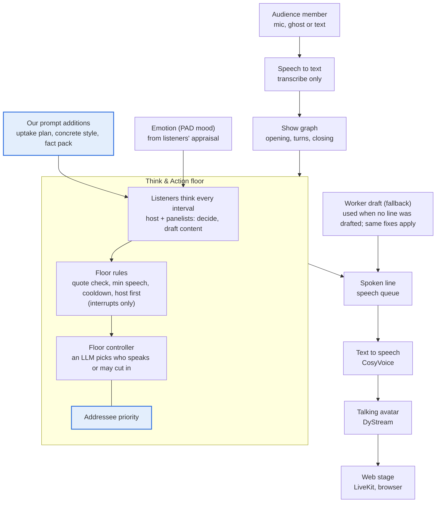
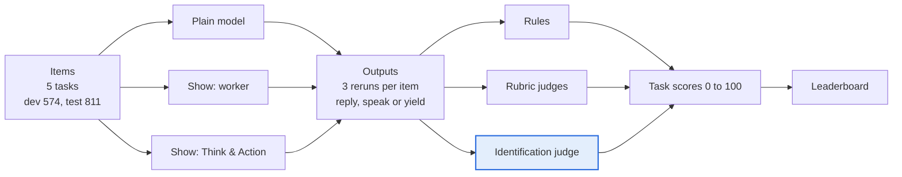

# Dialogue quality for the AI talk show

This document describes how we measure and improve what the AI panelists say. It covers four layers that sit on top of the show:

| Layer | Problem it addresses | Status |
| --- | --- | --- |
| Dialogue fixes | Panelists ignore what the audience said, nobody answers when a panelist is named, lines are vague | In `main` (#1), behind flags that are off by default, ported to Think & Action |
| Measurement tools | No way to tell whether a change helped | In `main` (#2) |
| Fact pack | Asking for concrete lines makes panelists invent facts | This branch |
| Benchmark | One fixed yardstick across systems and models | This branch |

The document is kept up to date; see the changelog at the end.

## System architecture

The line a panelist speaks is the `content` it drafts during its Think & Action call. So our prompt additions and the fact pack are added to the think prompt, and addressee priority is added to free-floor speaker selection. Floor rules, emotion, speech and the avatar belong to the rest of the team's system.

Blue boxes are our additions.

## Components

Every change to the show is behind a flag that is off by default. With the flags off, the panel prompts are byte-identical to `main`.

| Component | What it does | Where it hooks in | Flag |
| --- | --- | --- | --- |
| Addressee priority | If the audience names a panelist and that panelist chose to speak, they get the floor | Free-floor selection, `ThinkActionInteraction.arbitrate_free` | `TALKSHOW_ADDRESSEE_FLOOR=1` |
| Answer the audience | Lists the audience member's figures, names and stance, and asks the panelist to answer that point | Think prompt; extraction starts when the audience turn is committed | `TALKSHOW_UPTAKE_PLANNER=lite`, `TALKSHOW_PANEL_SCAFFOLD_FIX=1` |
| Concrete lines | Style examples that carry facts, and a one-concrete-fact rule | Think prompt and worker fallback | `TALKSHOW_DIALOGUE_LIBRARY=panel_concrete`, `TALKSHOW_PANEL_CONCRETE=1` |
| Fact pack | The 6 most relevant checked facts for the topic; specifics may come only from them or from what was said in the show | Think prompt and worker fallback | `TALKSHOW_FACT_PACK=<json>` |
| Listening test | Edit one element of the audience turn, replay, and check whether the reply changes | `eval/responsiveness.py`, `eval/judge_context.py`, replay hooks | `TALKSHOW_GHOST_REPLAY=1` |
| Quality ruler | Yes/no checklist scored by two judges plus counted metrics; every judge measure is validated before use | `eval/quality_ruler/` | none |
| Unsupported specifics | Counts numbers and names that have no source in the fact pack or the show so far | `eval/quality_ruler/specifics.py` | none |
| Benchmark | Fixed items, a common system interface, judges, leaderboard | `eval/bench/` | none |

The recommended set ("fast") turns on addressee priority, answer the audience and concrete lines. It is listed in `deploy/arms/dialogue-quality.arms`.

## Fact pack pipeline

72 topics, 1,482 facts (4 to 31 per topic), built without a paid search API.

1. **Search queries.** An open LLM rewrites each motion into 5 concrete Wikipedia queries. Debate titles are often slogans, so searching the title directly finds off-topic pages.
2. **Wikipedia.** The free API, with a pause between requests. Up to 10 articles and 160 candidate sentences per topic.
3. **Select and rewrite.** An open LLM picks up to 30 sentences that bear on the motion and rewrites each as one short fact.
4. **Re-link and verify.** The model often cites the wrong sentence number, and sometimes invents a fact. A program matches every fact back to its closest source sentence and keeps it only if at least 60% of its content words and all of its numbers appear there.

Known limits:
- Side labels (for/against) are unreliable, so both panelists get the same facts.
- The check only proves that a fact is in its Wikipedia sentence, not that Wikipedia is right.

Facts come from Wikipedia (CC BY-SA 4.0); every fact carries its page and URL.

## Benchmark

Any talk show system runs the same fixed items and is scored the same way. T1 to T4 are counterfactual pairs: run the original and an edited input, and check whether the output changes as it should.

| Task | What is edited | Good behaviour | Items (dev / test) |
| --- | --- | --- | --- |
| T1 Listening | A number, the stance, a named entity or a cause in the audience turn; a paraphrase as control | The reply changes with each edit; the paraphrase moves it no more than a rerun does | 150 / 243 |
| T2 Addressing | The audience names panelist A or B | Speak when named, yield when not | 120 / 168 |
| T3a Grounding, unprompted | The number in one fact of the pack; the audience asks about that fact | The reply uses the new value and adds no unsupported specifics | 92 / 116 |
| T3b Grounding, instructed | Same as T3a, plus "Use these facts when they are relevant to your reply." | Same | 92 / 116 |
| T4 Persona | The two persona cards are swapped | The style follows the card | 120 / 168 |
| T5 Hosting, T6 Full show | Not built yet | | |

**Splits.**
- Dev is 30 hand-written topics, used for tuning.
- Test is 42 motions from the [Intelligence Squared debates corpus](https://convokit.cornell.edu/documentation/iq2.html) ([Zhang et al., NAACL 2016](https://aclanthology.org/N16-1017/)), reported once. The test text is rebuilt locally from ConvoKit and never committed; only IDs and edits are.

**Scoring.**
- **Rules** cover what a program can check: who spoke, whether a number or name has a source, whether the reply states the edited value.
- **Rubric judges** answer yes/no questions that need reading. There are two judges from different model families (Qwen2.5-72B, Llama-3.3-70B), read from token probabilities.
- **Identification judge** handles every counterfactual pair. It sees one reply and both input versions and guesses which one the reply answered; 0.5 is chance.
- Every judge measure must pass three gates before use:
  - its score drops on lines we damage on purpose;
  - real human panels score above the system;
  - the two judges agree.

**Task scores.**
- Identification accuracy J maps to 200 × (J − 0.5).
- T2 uses balanced accuracy over "speak when named" and "yield when not named", so a system that always speaks or always yields scores 0.
- The overall score is the mean over T1, T2, T3a, T3b and T4.
- Each version runs 3 times. Rubric items are scored on the first rerun only, to save compute.

## Current results

These are pilot numbers on the dev split, averaged over both judges, on a 0 to 100 scale.

| System | Overall | T1 | T2 | T3a | T3b | T4 |
| --- | --- | --- | --- | --- | --- | --- |
| Plain Gemma-4 E4B | 39.4 | 42 | 2 | 35 | 37 | 81 |
| Plain Qwen2.5-7B | 30.0 | 31 | 6 | 35 | 35 | 43 |
| Our show (Think & Action, 3 arms) | pending | | | | | |

What these show:
- **The benchmark itself checks out.** The paraphrase control sits at J = 0.53, near chance. Persona separates the two models clearly (J 0.94 vs 0.63, intervals far apart). Listening also differs (J 0.71 vs 0.66), though those intervals touch.
- **Addressing.** Gemma never yields. Qwen yields 88% of the time, even when it is the one named.
- **Grounding.** With or without the instruction, only about 2% of replies use the edited value from the fact pack.

The fact pack was also tested offline with the earlier worker prompt path: 72 topics, 1,152 lines per arm.

| Measure | Current show | Fast | Fast + fact pack |
| --- | --- | --- | --- |
| Specificity (judged) | 0.49 | 0.65 | 0.77 |
| Argument quality (judged) | 0.59 | 0.71 | 0.79 |
| Lines with an unsupported specific | 0.5% | 4.6% | 0.6% |
| Persona fidelity (judged) | 0.73 | 0.74 | 0.68 |

With the fact pack, panelists say about 5 times more specifics than with the fast arm alone, and almost all of them have a source. The cost is weaker persona fidelity.

## Next steps

- [ ] Put the three Think & Action arms (production, fast, fast + fact pack) on the leaderboard.
- [ ] Run the full leaderboard on the test split: 11 open models plus the show.
- [ ] Open the fact pack and benchmark PRs, with results attached.
- [ ] Recover the persona fidelity lost with the fact pack; combine it with varied openers.
- [ ] Validate the judge prompts that have not passed the gates yet: fact-edit identification, and interrupt and backchannel scoring.
- [ ] Build T5 (hosting, with a fixed reference panel) and T6 (full show).

## Changelog

| Date | Change |
| --- | --- |
| 2026-11-11 | Merged `main` into the benchmark branch with no conflicts; the judge now exits cleanly when there is nothing to score; models resolve from the local cache or fail fast |
| 2026-11-11 | Benchmark pilot done: 2 models, 5 tasks, 2 judges |
| 2026-11-10 | Benchmark v1. Three design fixes from the pilot: drop implausible fact edits, ask about the edited fact and split T3 into a/b, let systems yield in T2 |
| 2026-11-10 | Environment spec and novelty check |
| 2026-11-10 | #1 and #2 ported to Think & Action and merged; #5 cleanup merged |
| 2026-11-09 | Fact pack for 72 topics; offline fact pack experiment; Think & Action pilot runs end to end |
| 2026-11-09 | #1 (dialogue fixes) and #2 (measurement tools) opened |
